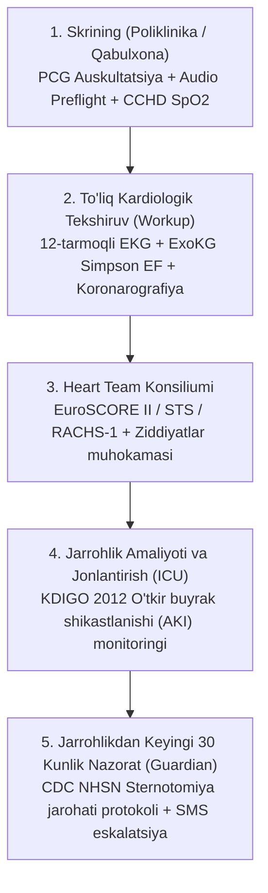

# CardioPath AI — Shifokor va Klinika Xodimlari Uchun Amaliy Qo'llanma

**Hujjat kodi:** `DOC-CP-CLIN-2026/01`  
**Amal qilish sohasi:** Kardiologiya bo'limi, Yurak-qon tomir jarrohligi, Qabulxona va skrining punktlari, Jonlantirish bo'limi (ICU), IT ma'muriyati.  
**Qonuniy asos:** O'zbekiston Respublikasi «Fuqarolar sog'lig'ini saqlash to'g'risida»gi Qonuni (24-modda), ISO 13485, IEC 62304 SaMD Class IIb.

---

## 1. Tizimning Klinik Maqsadi va Qat'iy Cheklovlar

> [!IMPORTANT]
> **Asosiy Klinik Invariant (CDSS Tamoyili):**
> CardioPath AI — bu shifokor qarorini qo'llab-quvvatlovchi intellektual yordamchi tizimdir (**CDSS**). U **mustaqil yakuniy tashxis qo'ymaydi** va **dori vositalari dozasini buyurmaydi**. Barcha klinik qarorlar, dori-darmon buyurish va jarrohlik amaliyotiga ko'rsatmalar faqat sertifikatlangan davolovchi shifokor yoki Heart Team konsiliumi tomonidan tasdiqlanadi.

* **Sun'iy intellekt faqat xavfni oshirishi mumkin:** Tizimda qat'iy `final_risk = max(rule, ai)` qoidasi amal qiladi. AI hech qachon xalqaro klinik ko'rsatmalarda (ESC, AHA, KDIGO) belgilangan xavf darajasini pasaytira olmaydi.
* **Shubha tug'ilganda tahlilni to'xtatish (Abstain-First):** Signal sifati past bo'lsa (shovqinli audio, artefaktli EKG, tushunarsiz laboratoriya), tizim yolg'on xulosa bermasdan tahlilni to'xtatadi (`ABSTAIN`).
* **Bemor ma'lumotlari maxfiyligi:** Tizimda bemorning F.I.Sh. va pasport ma'lumotlari saqlanmaydi — faqat shifoxona ichki kodi (`patient_ref`) ishlatiladi.

---

## 2. Bemorning Yozma Roziligi (Clinical Consent)

O'zbekiston Qonunchiligi va tibbiy etika qoidalariga ko'ra, har qanday sun'iy intellekt tahlili va invaziv aralashuvdan oldin bemorning rasmiy yozma roziligi olinishi shart.

1. Bemor qog'oz shakldagi rozilik blankini imzolaydi.
2. Tizimda **«Yozma rozilikni qayd etish»** bo'limida quyidagilar kiritiladi:
   * **Shifokor:** Rozilikni olgan kardiolog yoki jarrohning F.I.Sh.;
   * **Blank raqami:** Qog'oz hujjat arxividagi forma kodi (masalan, `ROZ-2026/0412`);
   * **Rozilik turi:** `treatment_and_ai` (Davolash va AI tahlili), `surgery_and_ai` (Jarrohlik amaliyoti va AI) yoki `telemedicine_guardian` (Masofaviy monitoring).
3. Ushbu yozuv avtomatik ravishda audit jurnaliga shifrlanadi va klinik epikrizga muhrlanadi.

---

## 3. Bosqichma-bosqich Klinik Ish Jarayoni

### 1-bosqich: Skrining (Poliklinika va Qabulxona)
* **Audio Pre-flight tekshiruvi:** Raqamli stetoskop bilan yozib olishdan oldin tizim 2 soniyali pre-flight test o'tkazadi (`POST /screening/preflight`). Spektral energiya (25–400 Hz yurak shovqini vs >600 Hz kiyim ishqalanishi) va shovqin darajasi (SNR) tekshiriladi.
* **CCHD Skriningi (Chaqaloqlar uchun):** O'ng qo'l va oyoqdagi $SpO_2$ o'lchanadi. Agar farq $>3\%$ yoki $SpO_2 < 90\%$ bo'lsa, zudlik bilan Qizil signal (Red Flag) beriladi.

### 2-bosqich: Kardiologiya Bo'limi (Workup)
* **12-tarmoqli EKG Pan-Tompkins Tahlili:** R-cho'qqilar, yurak urishi ($HR$), $PR$, $QRS$, $QT$ va $QTc$ (Bazett / Fridericia) aniq millisekundlarda hisoblanadi.
  * $QTc \ge 500$ ms bo'lsa — hayot uchun xavfli aritmiya xavfi (Qizil signal).
  * $PR > 210$ ms — AV-blokada darajasi.
  * $QRS \ge 120$ ms — qorincha ichi o'tkazuvchanligi buzilishi.
* **ExoKG Simpson EF:** Chap qorincha otib berish fraksiyasi ($EF \le 35\%$ — yuqori xavf).
* **Koronarografiya va LMS (Chap asosiy poya) stenozi:** Agar LMS $\ge 50\%$ stenozi aniqlansa, bemor avtomatik tarzda `VERY_HIGH` xavf toifasiga o'tkaziladi va shoshilinch jarrohlik konsiliumi belgilanadi.

### 3-bosqich: Heart Team Jarrohlik Konsiliumi
* **Operatsion o'lim xavfi:** EuroSCORE II, RACHS-1 (bolalar) va STS shkalalari bo'yicha deterministik hisoblash.
* **Qoidalar va AI o'rtasidagi ziddiyatlar (Concordance):** Agar klinik shkala past xavf ko'rsatib, AI modeli yuqori xavf bersa, tizim bu holatni konsilium muhokamasiga (Discussion Points) kiritadi. Shifokorlar ziddiyat sababini ko'rib chiqib, o'z xulosalarini bayonnomaga yozadilar.

### 4-bosqich: Jonlantirish Bo'limi (ICU) — Buyrak Nazorati
* **KDIGO 2012 AKI Staging:** Jarrohlikdan keyingi o'tkir buyrak shikastlanishini erta bosqichda aniqlash.
  * **Stage 1:** Kreatininning 48 soatda $\ge 26.5$ mkmol/l yoki 1.5–1.9 baravar oshishi;
  * **Stage 2:** Kreatininning 2.0–2.9 baravar oshishi yoki diurez $< 0.5$ ml/kg/soat (12 soat);
  * **Stage 3:** Kreatinin $\ge 3$ baravar yoki $\ge 353.6$ mkmol/l yoxud o'tkir gemodializ (RRT) talab etilishi.

### 5-bosqich: Jarrohlikdan Keyingi 30 Kunlik Nazorat (Guardian)
* **CDC NHSN / ASEPSIS Sternotomiya Jarohati Protokoli:** Bemor yoki hamshira tomonidan sternotomik chok holati baholanadi (qizarish, shish, ajralma, og'riq, harorat, to'sh suyagi beqarorligi).
* **Kritik Eskalatsiya (Red Alert):** Yiringli ajralma, to'sh suyagi qisirlashi/beqarorligi yoki 38.5°C dan yuqori isitma aniqlansa, navbatchi kardiojarrohga bir necha soniyada **avtomatik SMS xabarnoma** yuboriladi.

---

## 4. Tibbiy Hisobot va Xalqaro Integratsiya

### Rasmiy A4 Klinik Epikriz
Har bir bemor uchun `GET /episodes/{eid}/report` manzili orqali tayyor rasmiy epikriz olinadi:
* Shifoxona blanki va rasmiy rekvizitlari;
* Bemorning barcha bosqichdagi dalillari jadvali;
* Yozma rozilik kodi va sanasi;
* Konsilium a'zolari va davolovchi shifokor imzosi uchun maxsus joylar;
* **Chop etish:** Sahifadagi `🖨️ Chop etish / PDF sifatida saqlash` tugmasi bosiladi (Ctrl + P).

### HL7 FHIR R4 Standartida Eksport
Kasalxona axborot tizimlari (MIS / HIS / PACS / EHR) bilan ma'lumot almashish uchun:
* Sahifadagi `📥 HL7 FHIR R4 JSON` tugmasi yoki API: `GET /episodes/{eid}/fhir`.
* Standart bo'yicha `Bundle (type: document)` formatida de-identifikatsiyalangan `Composition`, `Patient`, `Consent`, `Observation` (LOINC kodlari bilan) va `RiskAssessment` resurslari taqdim etiladi.

---

## 5. IT Ma'muriyati va Xavfsizlik Qoidalari

1. **Zaxira nusxalar va tiklash tayyorgarligi (Restore Drill):**
   * Tizim har 24 soatda avtomatik zaxira nusxa (`.db.gz`) yaratadi.
   * Administrator istalgan vaqtda `POST /backups/restore-drill` chaqirib, zaxiraning to'liq tiklanuvchanligi va ma'lumotlar butunligini xotirada tekshirishi mumkin.
2. **Kriptografik Audit Butunligi:**
   * Tizimdagi har bir amaliyot `SHA-256 hash-chaining` orqali saqlanadi.
   * Jurnalning buzilmaganligini tekshirish: `GET /audit/verify`.
3. **Ish Stansiyasi Xavfsizligi:**
   * Bo'limdagi umumiy kompyuterlarda shifokor 15 daqiqa harakatsiz qolsa, ekran avtomatik qulflanadi va qayta PIN/parol talab qilinadi.
4. **Offline PWA Ish Rejimi:**
   * Internet yoki ichki tarmoq uzilib qolgan taqdirda ham, dastur kesh orqali interfeysni ushlab turadi va qizil ogohlantirish banneri orqali xodimni xabardor qiladi.
